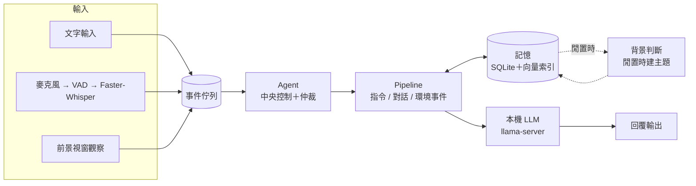

# AoFos（奧狐）

在一般筆電上**完全本機執行**的互動式 AI 虛擬角色。
目標是一個有固定個性、能聽、能記得、能主動開口的角色，參考對象是 AI VTuber「Neuro-sama」。

> 個人專案，2026 年 3 月開始開發，持續進行中。

---

## 目前狀態（2026-11）

| 部分 | 狀態 |
|---|---|
| 文字輸入 → 本機 LLM → 回覆 | ✅ 可運作 |
| 語音輸入（VAD＋Faster-Whisper） | ✅ 可運作 |
| 長期記憶（原句落地＋背景判斷建主題＋兩路檢索） | ✅ 可運作，持續調整中 |
| 前景視窗觀察 → 主動發話 | ✅ 可運作（僅 Windows） |
| VTube Studio 角色 | ⚠️ 已連線，尚未驅動表情與口型（要等語音輸出接上） |
| 語音輸出（GPT-SoVITS） | 🚧 單獨測試中，尚未接入主迴圈 |

---

## 系統架構



所有輸入都先變成「事件」放進同一個佇列，**只有 Agent 一個地方決定要不要回應**。
早期曾讓各個輸入來源自己決定要不要開口，來源一多就互相衝突，所以改成單一決策點。

---

## 設計重點

**1. 記憶：原句全部保存，索引另外建**
每一輪對話的原句都寫進 SQLite，不刪、不壓縮。
系統閒置時，背景判斷用同一顆模型讀過剛才的對話，決定「值不值得記」，值得就建成主題句當作索引。
回答前用「向量＋關鍵字」兩路檢索主題，把找到的內容放進 prompt。
使用者一開口，背景判斷就被取消、讓出推理資源，下次整段重判。

**2. 在有限硬體上做取捨**
開發機是 2019 年的筆電（GTX 1650 4GB 顯存、8GB 記憶體）。
推理後端的參數（context 長度、放上 GPU 的層數、快取大小）都是用 `tools/chat_probe.py` 一次只改一個變數實測後決定的，理由寫在 `config.py` 的註解裡。

**3. 每次修改都能驗證**
- `core/agent/selftest.py`、`core/memory/selftest_v4.py`：不需要模型、不碰真實資料的自我測試。
- `tools/chat_probe.py`：照劇本自動跑整場對話，量延遲、檢查記憶注入。
- `tools/eval_runner.py`＋`evaluation/blind_eval.py`：固定題本自動施測，去識別化後交給多位評審盲評，比較不同模型版本。

---

## 目錄結構

```
main.py                 啟動入口
config.py               所有設定集中在這裡（模型路徑、取樣參數、記憶參數）
core/
  agent/                Agent（中央控制、仲裁）、Pipeline（流程）、事件佇列
  memory/               記憶：原句存放、背景判斷、主題索引、檢索
  producers/            輸入來源：文字、前景視窗觀察
  llm_client.py         連接本機推理後端（OpenAI 相容 API）
  voice_input.py        麥克風收音＋VAD＋語音辨識
  vtube_client.py       VTube Studio WebSocket 連線
  persona.py            角色設定與 prompt 組裝
prompts/                角色 prompt、記憶判斷規則
worldview/              角色的身份設定
tools/                  後端啟動、對話探測、自動施測、記憶審核
evaluation/             評測題本與盲評工具
start/                  Windows 一鍵啟動腳本
```

---

## 執行方式

**環境**：Windows、Python 3.10 以上、[llama.cpp](https://github.com/ggml-org/llama.cpp) 的 `llama-server`、一個 GGUF 格式的語言模型。

1. 安裝套件：`pip install -r requirements.txt`
2. 打開 `config.py`，把 `LLAMA_SERVER` 裡的 `exe`、`model` 等路徑改成自己電腦上的位置。
3. 執行 `start/啟動推理後端.bat`，等模型載入完成。
4. 執行 `start/啟動.bat`，開始對話。

自我測試（不需要模型）：

```
python -m core.agent.selftest
python -m core.memory.selftest_v4
```

---

## 不在這個 repo 裡的東西

- `data/`：對話記憶資料庫（個人資料，不上傳）
- `logs/`：執行紀錄
- 模型權重
- 開發紀錄文件（程式註解中引用的《現況》《歸檔》等）
